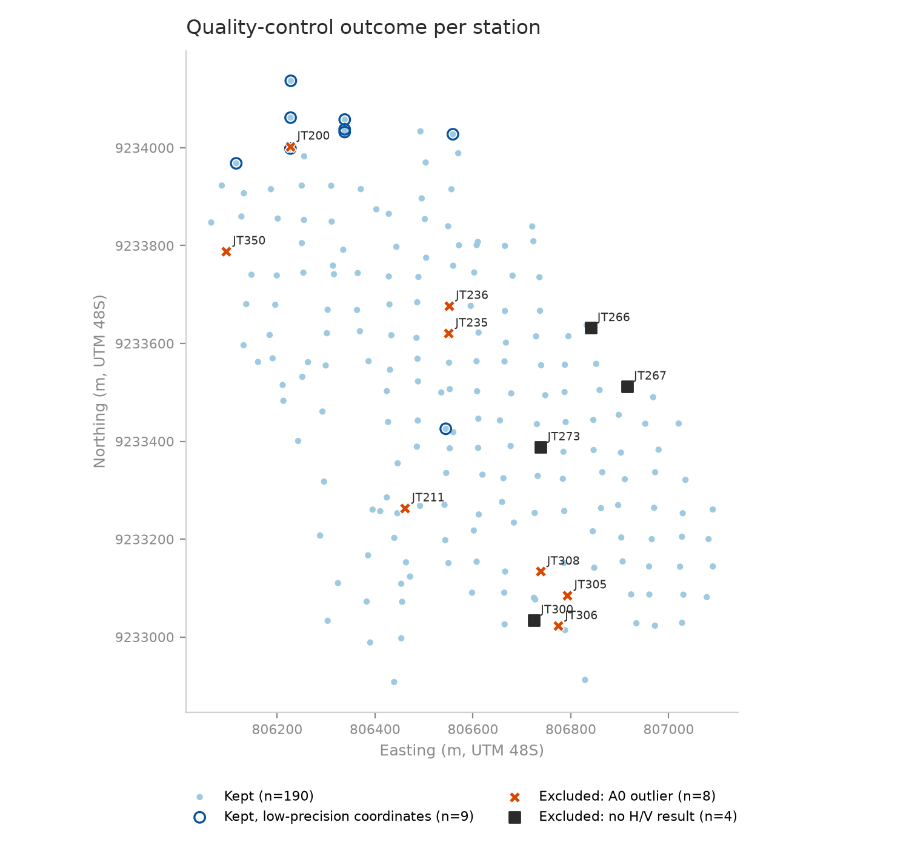
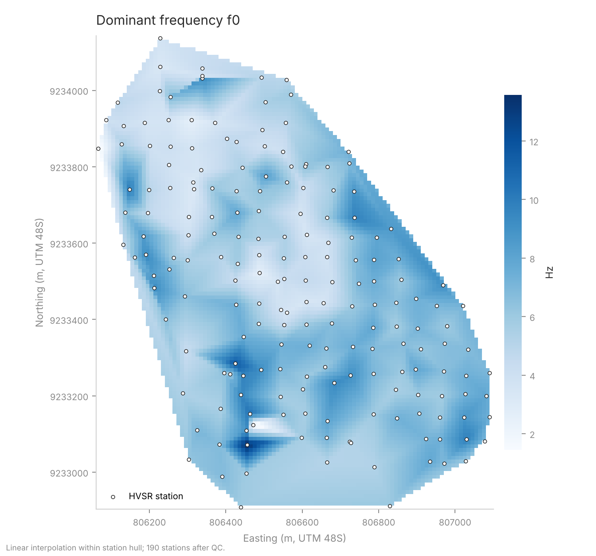
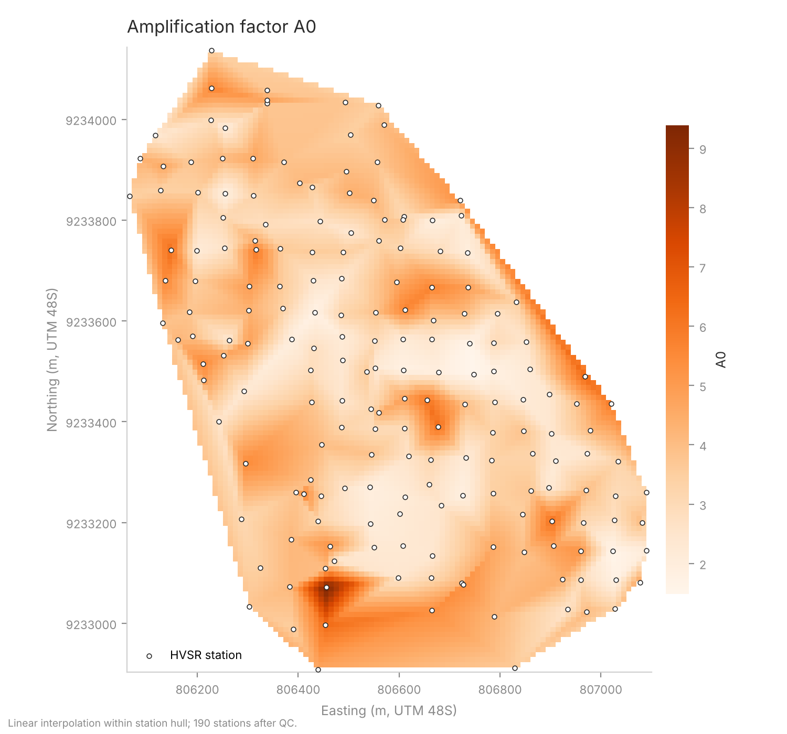
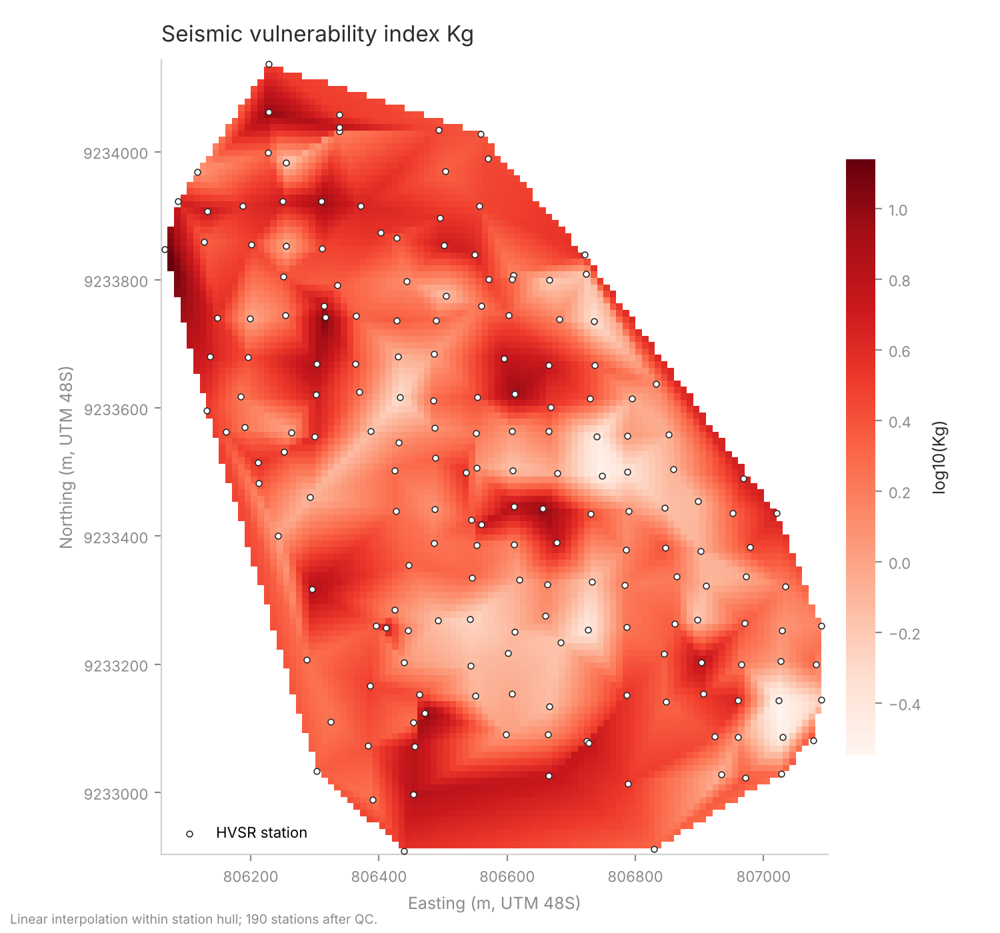
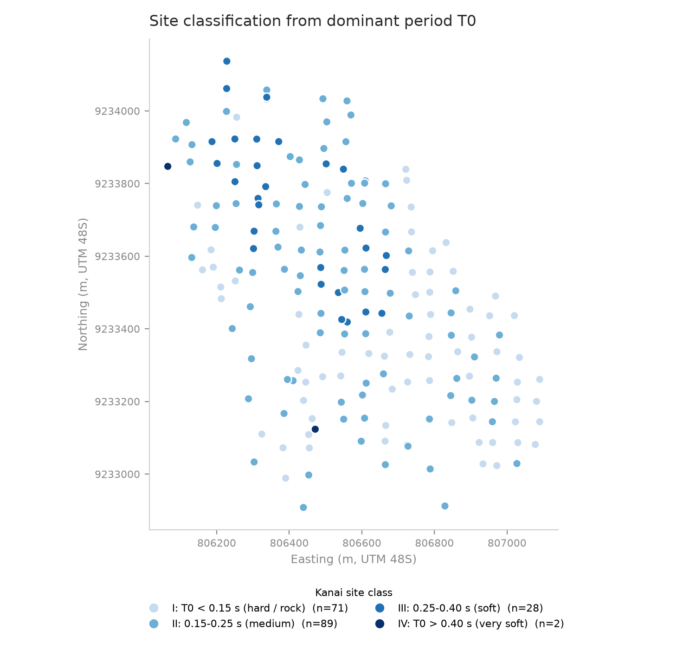

# HVSR Seismic Microzonation: South Campus, Universitas Padjadjaran (Jatinangor, Sumedang)

[](https://github.com/Madkinny/hvsr-unpad-south-microzonation/actions/workflows/ci.yml) [](https://doi.org/10.5281/zenodo.24447972)

Reproducible quality control and mapping of **202 single-station HVSR (microtremor H/V)
measurements** collected on a ~50 m grid across the southern part of the UNPAD Jatinangor
campus, West Java, Indonesia (March–June 2025). After documented QC, **190 stations** are
used to map dominant frequency (f0), amplification (A0), seismic vulnerability index (Kg)
and site class.



## At a glance

| | |
|---|---|
| Stations surveyed | 202, over 13 field days (8 Mar – 15 Jun 2025) |
| Stations after QC | 190 |
| Recording length | mostly 30 min (some 20 min and 10 min) |
| CRS | WGS84 lon/lat → UTM zone 48S (EPSG:32748) |
| f0 (clean) | 0.64–14.0 Hz, median 6.07 Hz |
| A0 (clean) | 1.46–9.56, median 3.47 |
| Kg (clean) | 0.28–16.4, median 2.04 |

## My role

- **Field acquisition:** operated microtremor instruments in the field as one of the
  survey operators.
- **Data processing:** processed the microtremor recordings into H/V spectral ratios and
  picked the dominant frequency (f0) and amplification factor (A0) for the dataset.
- **Mapping:** produced the original spatial zonation maps in QGIS.
- **This repository:** audited the tabulated results, wrote the QC and mapping pipeline in
  Python, and rebuilt the maps reproducibly from the raw table.

Fieldwork was carried out by a 6-member student team under faculty supervision, Department of
Geophysics, Universitas Padjadjaran.

## Quality control

The original spreadsheet was audited before any mapping. Every decision is applied in code
(`src/hvsr_zonation/qc.py`), driven by thresholds in `config.toml`, and logged per station in
`data/processed/qc_log.csv`. Full details: [`outputs/qc_report.md`](outputs/qc_report.md).

| Issue found | Stations | Action |
|---|---|---|
| No H/V result (coordinates lost; North component not recorded) | 4 | Excluded |
| A0 > 10: implausibly high peak amplitude (up to 85), likely an unreliable H/V peak | 8 | Excluded |
| Station IDs reused on different days at different locations (JT224–JT227) | 4 pairs | Relabelled `a`/`b` by survey date |
| Whitespace inside latitude values (`-6. 925219`) | 2 | Fixed |
| Coordinates recorded with only 3 decimal degrees (~±55 m, i.e. about one grid cell) | 10 | Kept, flagged `low_precision_coords` |
| Derived columns T0 = 1/f0 and Kg = A0²/f0 | all | Recomputed and verified |

Why A0 > 10 is screened: the original SESAME (2004) reliability flags were not kept with the
tabulated results, and the raw recordings are no longer available for reprocessing. A fixed
amplitude ceiling is used as a transparent substitute and can be changed in `config.toml`.

## Results

| Dominant frequency f0 | Amplification A0 |
|---|---|
|  |  |

| Vulnerability index Kg (log scale) | Site class (Kanai, from T0) |
|---|---|
|  |  |

Site classes among the 190 clean stations: class I 71, class II 89, class III 28, class IV 2.

**Spatial pattern.** Splitting the survey extent into four equal quadrants, the **north-western** quadrant stands out. It has the lowest
median f0 (4.87 Hz vs. 6.25–6.80 Hz in the other quadrants) and the highest median Kg (2.58 vs.
1.44–1.93). It also holds 20 of the 30 class III–IV (soft-soil) stations. The east and south-east
are dominated by higher f0 and lower Kg, consistent with stiffer or thinner sediments. Across
the area, f0 decreases northward (r = −0.40 with northing) and increases eastward (r = 0.32).

**Implications.** Higher Kg in the north-west suggests greater potential ground-motion
amplification there. This makes the north-west the first priority for site-specific
geotechnical investigation before new construction. Two isolated stations with unusually low
f0 (JT219: 0.64 Hz; JT351: 0.72 Hz, also the highest Kg at 16.4) should be re-measured with a
longer recording before being used for design decisions.

## Method notes

- **Projection:** coordinates are projected to UTM 48S before gridding so that distances are
  in metres, not degrees. The transverse Mercator projection is implemented in NumPy
  (Krüger series) and unit-tested against known invariants.
- **Interpolation:** linear (Delaunay) interpolation on a 10 m grid, limited to the convex hull
  of the stations. No extrapolation beyond measured points.
- **Kg** is mapped on a log scale because its distribution is strongly right-skewed.
- **Limitations:** results are only as reliable as the original H/V picks. Ten stations have
  low-precision coordinates. 10–20 min recordings are short for low-f0 sites under SESAME
  guidelines. Interpolated surfaces are smooth estimates between stations, not measurements.

## GIS outputs

- `outputs/gis/hvsr_south_stations.gpkg`: 190 QC'd stations (EPSG:32748), ready for QGIS
- `outputs/gis/hvsr_south_grids.nc`: gridded f0, A0 and log10(Kg) as a CF-style NetCDF (xarray)

The NumPy UTM projection is cross-checked against pyproj on every run (tolerance 1 cm).

## AI-evaluation benchmark task

[`benchmark/hvsr_qc_task/`](benchmark/hvsr_qc_task/) turns this dataset into an AI-training task:
a prompt with realistic data traps, a 100-point rubric, an automated grader that diagnoses
projection errors (missing false northing, wrong UTM zone, swapped axes), and a worked example
of a flawed submission with its grade.

## Reproduce

```bash
pip install -r requirements.txt
PYTHONPATH=src python -m hvsr_zonation.pipeline   # raw CSV -> QC -> clean CSV, report, maps
pytest -q                                          # projection, QC rules, dataset invariants
```

## Repository layout

```
data/raw/hvsr_south_raw.csv          202 stations exactly as recorded (crew names removed)
data/processed/hvsr_south_clean.csv  190 stations after QC, with UTM coordinates + site class
data/processed/qc_log.csv            one row per QC decision
scripts/export_from_excel.py         how the raw CSV was derived from the field workbook
src/hvsr_zonation/                   projection, QC, mapping, pipeline
outputs/                             QC report and maps
```

## Data provenance and privacy

`data/raw/hvsr_south_raw.csv` was exported from the team's field workbook with
`scripts/export_from_excel.py`. Field-crew names and free-text site notes were removed. The
workbook itself is not published.

## License and citation

Code: MIT. Data: CC BY 4.0 [ISI: confirm with supervisors]. If you use this dataset, please
cite it via the Zenodo DOI: [10.5281/zenodo.24447972](https://doi.org/10.5281/zenodo.24447972).
